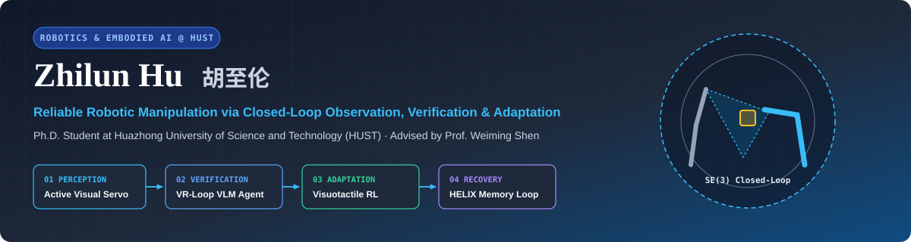
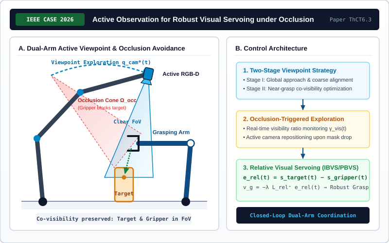
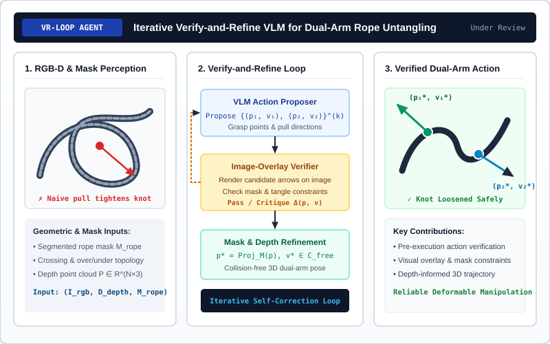
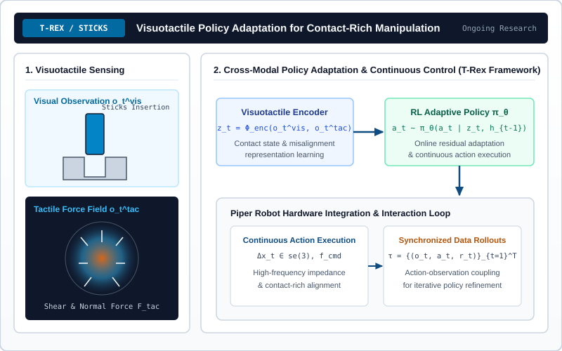
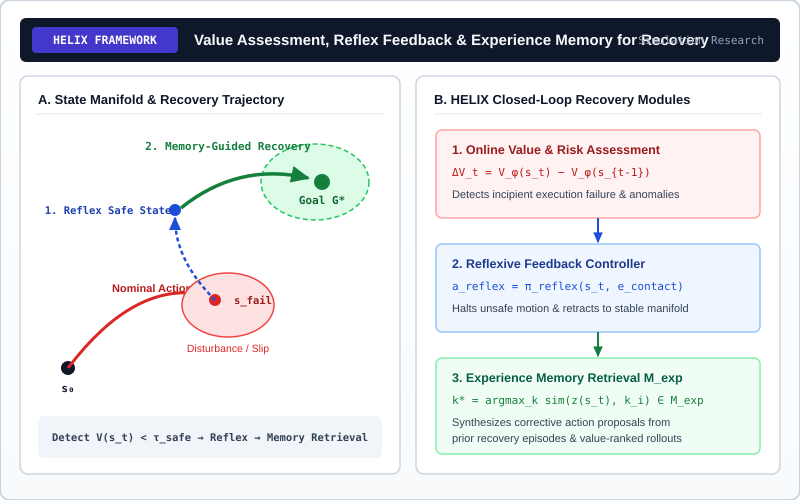

  

   

  

    
    
    
    
  

---

### About Me · 个人简介

I am **Zhilun Hu (胡至伦)**, a Ph.D. student in the School of Mechanical Science and Engineering at **Huazhong University of Science and Technology (HUST)**, advised by **[Prof. Weiming Shen](https://mse.hust.edu.cn/info/1143/1385.htm)** (IEEE Fellow, Academician of CAE).

My research centers on **Reliable Robotic Manipulation**—investigating how physical agents actively acquire unoccluded observations, verify high-level action proposals against geometric constraints prior to execution, adapt policies through visuotactile interaction, and recover from execution anomalies.

> 我是**胡至伦**，华中科技大学机械科学与工程学院博士研究生，师从**[沈卫明教授](https://mse.hust.edu.cn/info/1143/1385.htm)**。我的研究致力于解决**机器人操作中的可靠性问题（Reliable Robotic Manipulation）**，构建从**主动视觉伺服感知**、**双臂柔性操作先验视觉校验**、**视触觉强化学习策略自适应**到**故障恢复与经验记忆**的完整闭环架构。

- **Academic Homepage (Main)**: [https://169884902hzl.github.io/hzlink-academicpages/](https://169884902hzl.github.io/hzlink-academicpages/)
- **Curriculum Vitae & Full Publications**: [CV](https://169884902hzl.github.io/hzlink-academicpages/cv/) · [Publications](https://169884902hzl.github.io/hzlink-academicpages/publications/) · [Projects](https://169884902hzl.github.io/hzlink-academicpages/#projects)

---

### Research Architecture · 闭环可靠操作体系

<table>
  <thead>
    <tr>
      <th align="left">Pillar</th>
      <th align="left">Research Thrust</th>
      <th align="left">Core Technical Mechanism</th>
      <th align="left">Representative Work</th>
    </tr>
  </thead>
  <tbody>
    <tr>
      <td><code>01 · PERCEPTION</code></td>
      <td><strong>Active Perception &amp; Visual Servoing</strong></td>
      <td>Dual-arm viewpoint planning &amp; target–gripper relative image error feedback under occlusion</td>
      <td><a href="https://169884902hzl.github.io/hzlink-academicpages/portfolio/active-observation/"><strong>Active Observation</strong></a> <em>(IEEE CASE 2026)</em></td>
    </tr>
    <tr>
      <td><code>02 · VERIFICATION</code></td>
      <td><strong>Pre-Execution VLM Verification</strong></td>
      <td>Iterative image-overlay action critique, mask projection &amp; depth-informed 3D geometry</td>
      <td><a href="https://169884902hzl.github.io/hzlink-academicpages/portfolio/vr-loop/"><strong>VR-Loop</strong></a> <em>(Under Review)</em></td>
    </tr>
    <tr>
      <td><code>03 · ADAPTATION</code></td>
      <td><strong>Visuotactile Policy Learning</strong></td>
      <td>Cross-modal RGB + tactile force field fusion with RL policy adaptation on Piper hardware</td>
      <td><a href="https://169884902hzl.github.io/hzlink-academicpages/portfolio/visuotactile-adaptation/"><strong>T-Rex / Sticks</strong></a> <em>(Ongoing)</em></td>
    </tr>
    <tr>
      <td><code>04 · RECOVERY</code></td>
      <td><strong>Failure Recovery &amp; Memory</strong></td>
      <td>Online value assessment, reflexive safe retraction &amp; episodic experience memory retrieval</td>
      <td><a href="https://169884902hzl.github.io/hzlink-academicpages/portfolio/helix/"><strong>HELIX</strong></a> <em>(Ongoing)</em></td>
    </tr>
  </tbody>
</table>

---

### Selected Publications & Preprints · 代表性论文

<table>
  <tr>
    <td width="34%" valign="middle" align="center">
      
    </td>
    <td width="66%" valign="top">
      

        
        
      

      <h4><a href="https://169884902hzl.github.io/hzlink-academicpages/portfolio/active-observation/">Active Observation for Robust Visual Servoing in Robotic Manipulation</a></h4>
      
<strong><u>Zhilun Hu</u></strong>, Yuqi Cheng, Yuxiang Tan, Wen-pan Li, Weiming Shen. 
      <em>IEEE International Conference on Automation Science and Engineering (CASE)</em>, 2026 · Paper ThCT6.3.

      
Coordinating an active eye-in-hand RGB-D camera arm with a grasping arm via a two-stage viewpoint strategy, target–gripper relative visual servoing, and occlusion-triggered viewpoint exploration.

      

        <a href="https://169884902hzl.github.io/hzlink-academicpages/portfolio/active-observation/"><strong>[Project Page]</strong></a> ·
        <a href="https://ras.papercept.net/conferences/scripts/rtf/CASE26_ContentListWeb_4.html"><strong>[Official Program (ThCT6.3)]</strong></a> ·
        <a href="https://169884902hzl.github.io/hzlink-academicpages/publication/active-observation/"><strong>[BibTeX]</strong></a>
      

    </td>
  </tr>
  <tr>
    <td width="34%" valign="middle" align="center">
      
    </td>
    <td width="66%" valign="top">
      

        
        
      

      <h4><a href="https://169884902hzl.github.io/hzlink-academicpages/portfolio/vr-loop/">Iterative Verify-and-Refine Vision-Language Agent for Reliable Dual-Arm Manipulation</a></h4>
      
Yuqi Cheng, <strong><u>Zhilun Hu</u></strong>, Cheng Jiang, Qingyu Peng, Weiming Shen. 
      <em>Manuscript under review</em>, 2026.

      
A closed-loop Verify-and-Refine Vision-Language Agent that renders proposed dual-arm actions onto image overlays, critiques crossing topology and mask constraints prior to execution, and synthesizes depth-informed 3D trajectories for rope untangling.

      

        <a href="https://169884902hzl.github.io/hzlink-academicpages/portfolio/vr-loop/"><strong>[Project Page]</strong></a> ·
        <a href="https://169884902hzl.github.io/hzlink-academicpages/publication/vr-loop/"><strong>[BibTeX]</strong></a>
      

    </td>
  </tr>
</table>

---

### Ongoing Research Projects · 在研课题与系统架构

<table>
  <tr>
    <td width="50%" valign="top">
      
      <h4><a href="https://169884902hzl.github.io/hzlink-academicpages/portfolio/visuotactile-adaptation/">T-Rex / Sticks: Visuotactile Policy Adaptation</a></h4>
      
<em>Visuotactile Learning · Ongoing Research</em>

      
Coupling visual observations and tactile shear/normal force fields with reinforcement learning for contact-rich insertion tasks on a Piper robot platform.

    </td>
    <td width="50%" valign="top">
      
      <h4><a href="https://169884902hzl.github.io/hzlink-academicpages/portfolio/helix/">HELIX: Failure Recovery &amp; Experience Memory</a></h4>
      
<em>Failure Recovery · Ongoing Simulation Research</em>

      
Integrating online value/risk assessment, fast reflexive retraction feedback, and episodic experience memory retrieval to recover from manipulation failures.

    </td>
  </tr>
</table>
